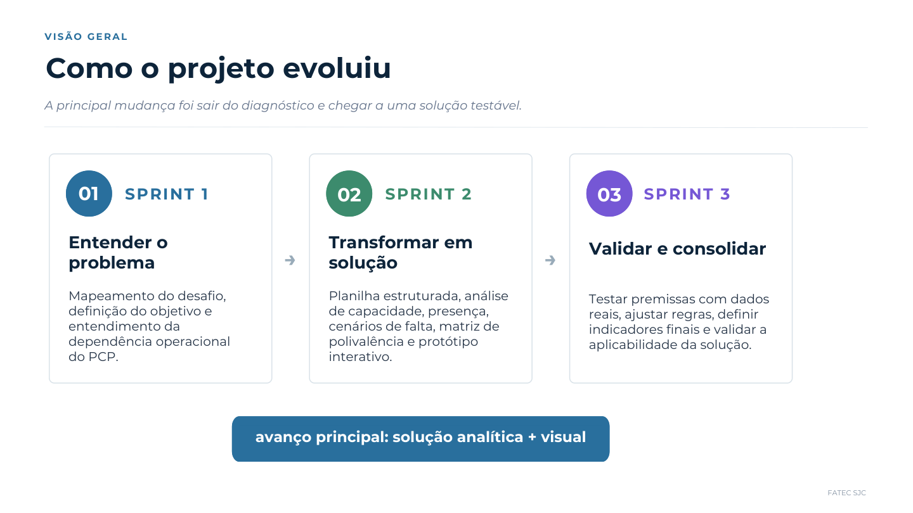
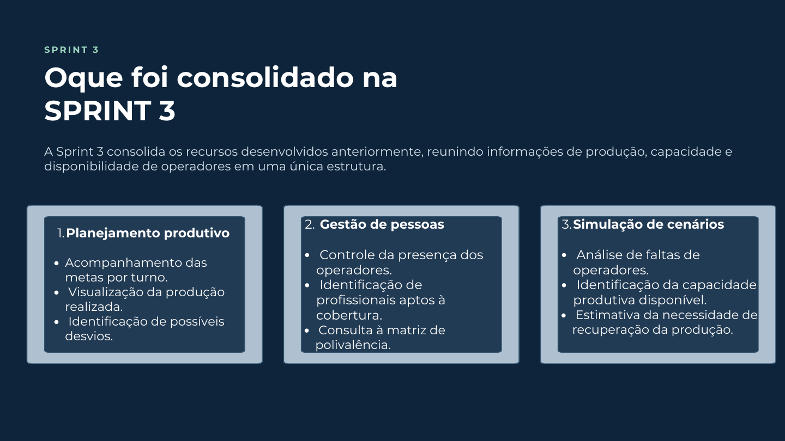
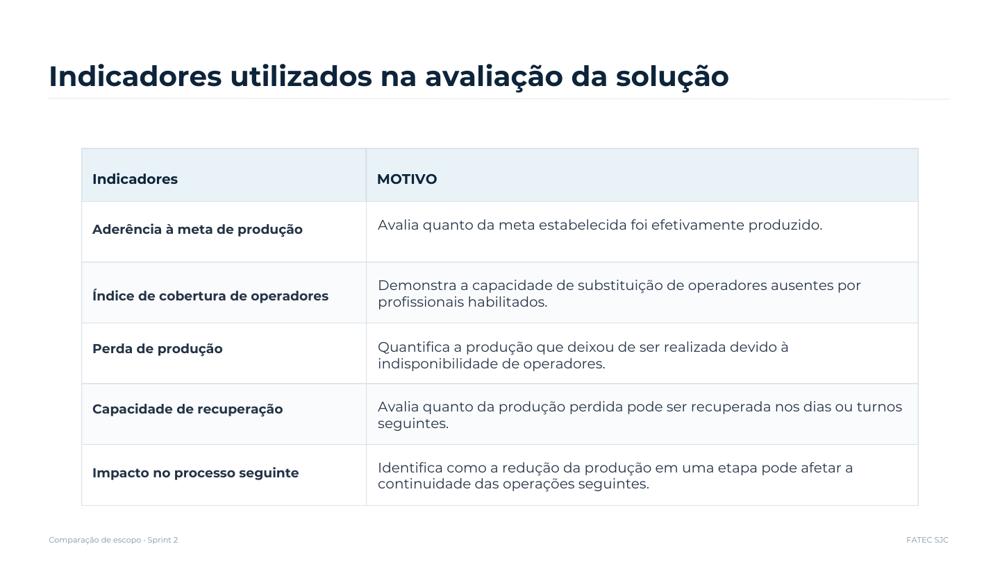
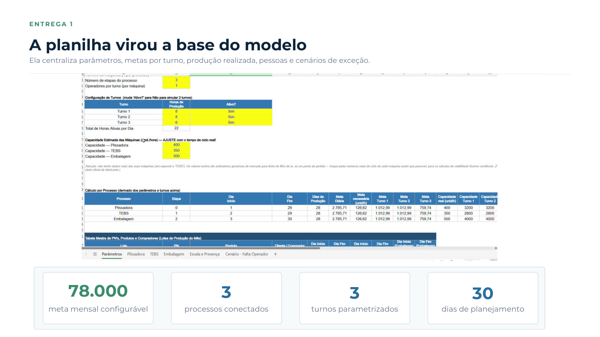
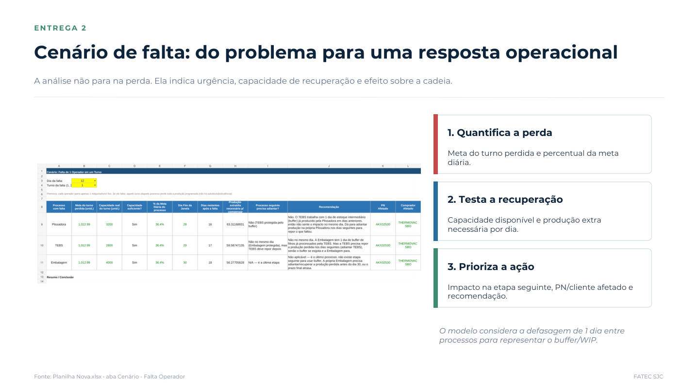
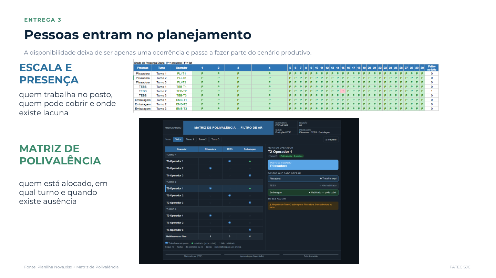
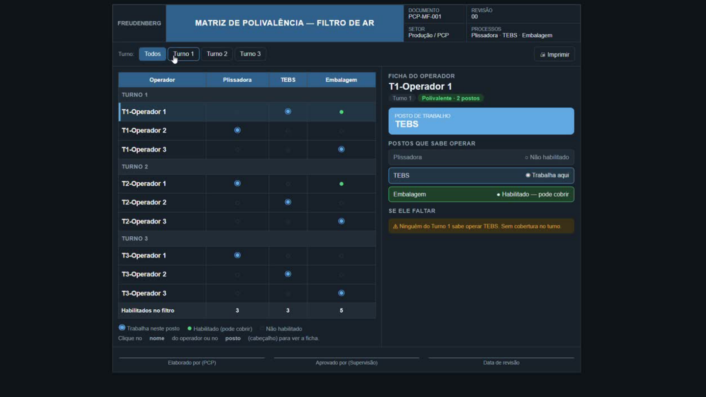
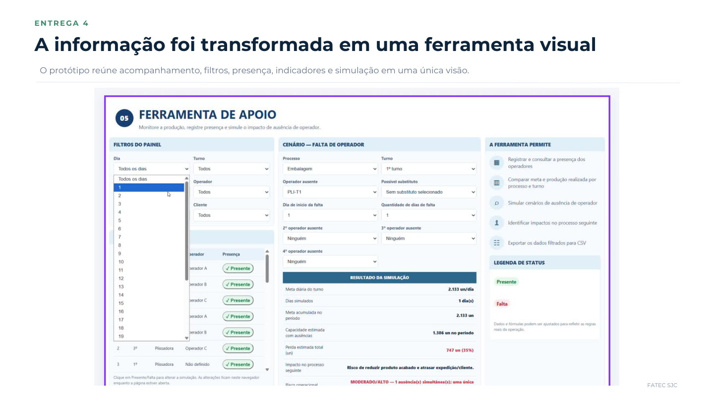
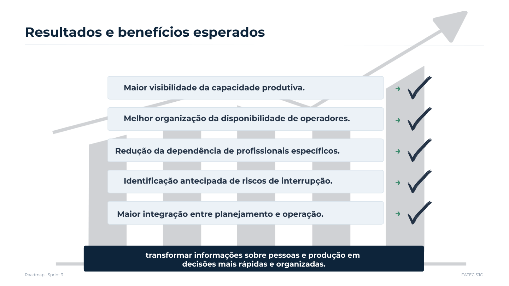
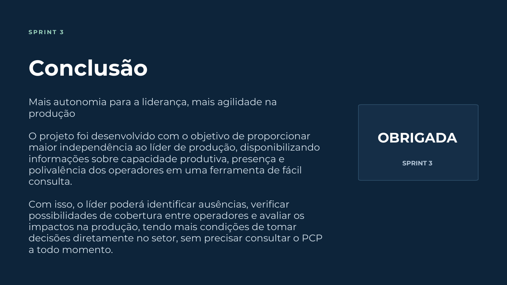

<h1 align="center">🏭 Projeto — Autonomia e Polivalência na Produção</h1>

<h3 align="center">Da análise do problema a uma ferramenta de apoio à decisão</h3>

<strong>Projeto Integrador | Gestão da Produção Industrial — FATEC São José dos Campos</strong>

---

## 👥 Integrantes do Projeto

| Integrante | Participação |
|---|---|
| Rafaela Moreira | Scrum Master |
| Maria Fernanda | Product Owner |
| Anita Leonel | Equipe do projeto |
| Daniella Araujo | Equipe do projeto |
| Karolini Gabrielle | Equipe do projeto |

**Professor:** Prof. Esp. Rodrigo Elias Pereira  
**Instituição:** FATEC São José dos Campos — Prof. Jessen Vidal  
**Curso:** Gestão da Produção Industrial

## 👤 Cliente e Contexto

O projeto foi desenvolvido a partir de um desafio operacional da **empresa parceira Freudenberg**, relacionado à autonomia da liderança de produção e ao aproveitamento da polivalência dos operadores.

**Representante do cliente:** *[Preencher, caso seja autorizado divulgar]*  
**Registros de feedback e validação:** *[Inserir link, se disponível e autorizado]*

---

# 📌 Descrição Geral

Este repositório documenta o desenvolvimento do projeto **Autonomia e Polivalência na Produção**, com foco em uma solução de **apoio à tomada de decisão na operação industrial**.

O desafio consistiu em compreender a dependência do **Planejamento, Programação e Controle da Produção (PCP)** nas decisões do dia a dia, especialmente em situações de ausência de operadores. Uma falta pode comprometer metas por turno, reduzir a capacidade disponível e afetar as etapas seguintes do processo produtivo.

Para apoiar a liderança nesses cenários, o grupo desenvolveu uma estrutura que integra **planejamento produtivo, metas, produção realizada, escala e presença de operadores, matriz de polivalência e simulação de cenários de falta**, além de um **protótipo visual** para consulta das informações.

A proposta é permitir que o líder identifique ausências, verifique possíveis coberturas e avalie impactos na produção com maior agilidade, sem precisar consultar o PCP a todo momento.

### 🎯 Objetivos

- Ampliar a autonomia da liderança nas decisões operacionais.
- Reunir informações de produção, capacidade e disponibilidade de pessoas.
- Identificar operadores habilitados para cobrir postos em situações de ausência.
- Estimar perdas de produção e possibilidades de recuperação.
- Antecipar riscos para as operações seguintes.
- Oferecer uma visualização prática dos cenários para apoiar decisões no setor.

### 🔧 Principais entregas

- Planilha estruturada de planejamento e acompanhamento produtivo.
- Simulação de cenários de falta de operadores.
- Escala, controle de presença e matriz de polivalência.
- Ferramenta visual de apoio à decisão.
- Indicadores para avaliação da solução.

---

# 📅 Evolução do Projeto — 3 Sprints

A evolução do projeto ocorreu em três etapas: **entender o problema, transformar o diagnóstico em uma solução e consolidar uma ferramenta testável**.

### 📸 Visão geral das sprints — Slide 2

## 📅 Sprint 1 — Diagnóstico do Problema

### ✔ Entregas principais

- Mapeamento do desafio operacional.
- Definição do objetivo do projeto.
- Entendimento da dependência da operação em relação ao PCP.
- Identificação das informações necessárias à tomada de decisão.

**Resultado:** compreensão do problema e direcionamento da solução proposta.

## 📅 Sprint 2 — Estruturação da Solução

### ✔ Entregas principais

- Estruturação da planilha de planejamento produtivo.
- Análise de capacidade e presença dos operadores.
- Organização de cenários de ausência.
- Desenvolvimento da matriz de polivalência.
- Elaboração de um protótipo interativo.

**Resultado:** transformação do diagnóstico em uma **solução analítica e visual**.

## 📅 Sprint 3 — Validação e Consolidação

### ✔ Entregas principais

- Consolidação das informações de produção, capacidade e disponibilidade de operadores.
- Teste de premissas com dados reais, conforme o escopo apresentado.
- Ajuste das regras do modelo e definição de indicadores finais.
- Avaliação da aplicabilidade da solução.
- Integração dos recursos em uma estrutura de consulta operacional.

A solução consolidada está organizada em **três frentes**:

1. **Planejamento produtivo:** acompanhamento de metas por turno, produção realizada e possíveis desvios.
2. **Gestão de pessoas:** presença dos operadores, profissionais aptos à cobertura e matriz de polivalência.
3. **Simulação de cenários:** análise de faltas, capacidade disponível e necessidade de recuperação da produção.

### 📸 Consolidação da Sprint 3 — Slide 3

---

# 📈 Indicadores de Avaliação da Solução

Os indicadores foram definidos para avaliar o desempenho produtivo e os efeitos da indisponibilidade de operadores.

| Indicador | Finalidade |
|---|---|
| **Aderência à meta de produção** | Avaliar quanto da meta estabelecida foi efetivamente produzido. |
| **Índice de cobertura de operadores** | Demonstrar a possibilidade de substituição de operadores ausentes por profissionais habilitados. |
| **Perda de produção** | Quantificar a produção não realizada devido à indisponibilidade de operadores. |
| **Capacidade de recuperação** | Avaliar quanto da produção perdida pode ser recuperada nos turnos ou dias seguintes. |
| **Impacto no processo seguinte** | Identificar efeitos da redução de produção sobre a continuidade das etapas seguintes. |

### 📸 Quadro de indicadores — Slide 4

---

# 🛠️ Entregas Técnicas

## 📊 Entrega 1 — Planilha de Planejamento Produtivo

A planilha tornou-se a **base do modelo**, centralizando parâmetros de operação, metas por turno, produção realizada, informações de pessoas e cenários de exceção.

Na configuração apresentada na Sprint 3, o modelo contempla:

| Parâmetro | Valor apresentado |
|---|---:|
| Meta mensal configurável | **78.000** |
| Processos conectados | **3** |
| Turnos parametrizados | **3** |
| Dias de planejamento | **30** |

### 📸 Base de planejamento — Slide 5

### 🎥 Demonstração em vídeo — Planejamento produtivo

O vídeo mostra a navegação pela planilha, incluindo configurações, planejamento, produção por processo e registros utilizados na análise operacional.

▶️ **[Assistir à demonstração da planilha](./videos/video-01-planilha-planejamento.mp4)**

---

## ⚠️ Entrega 2 — Simulação de Falta de Operador

A análise de ausência não se limita a registrar a falta: o modelo procura transformar a ocorrência em uma **resposta operacional**, considerando seus efeitos na produção.

O cenário foi dividido em três etapas:

1. **Quantificar a perda:** identificar a meta do turno comprometida e o percentual relacionado à meta diária.
2. **Testar a recuperação:** verificar a capacidade disponível e a produção adicional necessária por dia.
3. **Priorizar a ação:** considerar o impacto na etapa seguinte, o **PN/cliente afetado** e a recomendação operacional.

O modelo também considera uma **defasagem de um dia entre processos**, representando o *buffer* ou estoque em processo (**WIP**).

### 📸 Cenário de falta — Slide 6

---

## 👷 Entrega 3 — Escala, Presença e Matriz de Polivalência

A disponibilidade dos operadores passa a integrar o planejamento produtivo, permitindo visualizar **quem está presente, quem está alocado e quem pode atuar em outro posto**.

### Escala e presença

- Identificação dos operadores por turno e posto.
- Consulta da situação de presença e das ausências.
- Visualização de possíveis lacunas de cobertura.

### 📸 Escala e presença — Slide 7

### Matriz de polivalência

- Consulta das habilidades dos operadores por processo ou posto.
- Identificação de profissionais habilitados para substituição.
- Apoio à escolha de alternativas diante de faltas.

### 📸 Matriz de polivalência — Slide 8

### 🎥 Demonstração em vídeo — Matriz de polivalência

O vídeo apresenta a consulta interativa à matriz, com filtros por turno e seleção de operadores para visualizar os postos em que podem atuar.

▶️ **[Assistir à demonstração da matriz de polivalência](./videos/video-02-matriz-polivalencia.mp4)**

---

## 💻 Entrega 4 — Ferramenta Visual de Apoio à Decisão

O protótipo consolida informações e recursos em uma interface com **filtros, acompanhamento produtivo, presença dos operadores, indicadores e simulação**.

Sua finalidade é tornar a consulta mais objetiva e permitir que a liderança analise cenários de ausência e suas consequências diretamente no setor produtivo.

### 📸 Interface da ferramenta — Slide 9

### 🎥 Demonstração em vídeo — Ferramenta de apoio à decisão

O vídeo percorre a interface do protótipo, demonstrando filtros, presença dos operadores, simulação de faltas, indicadores e acompanhamento da produção.

▶️ **[Assistir à demonstração da ferramenta visual](./videos/video-03-ferramenta-apoio-decisao.mp4)**

**Acesso ao protótipo:** *[Adicionar link, se houver e for permitido compartilhar]*  
**Acesso à planilha:** *[Adicionar link, se houver e for permitido compartilhar]*

---

# ✅ Resultados e Benefícios Esperados

A proposta busca contribuir para:

- **Maior visibilidade** da capacidade produtiva.
- **Melhor organização** da disponibilidade dos operadores.
- **Redução da dependência** de profissionais específicos.
- **Identificação antecipada** de riscos de interrupção.
- **Maior integração** entre planejamento e operação.

> Transformar informações sobre pessoas e produção em decisões mais rápidas e organizadas.

Os pontos acima são **benefícios esperados** apresentados no projeto, não resultados quantitativos de implantação já comprovados.

### 📸 Resultados esperados — Slide 10

---

# 📌 Backlog Geral do Projeto

| Item | Atividade | Situação apresentada |
|---|---|---|
| 1 | Mapeamento do desafio operacional | Desenvolvido na Sprint 1 |
| 2 | Estruturação do planejamento e análise de capacidade | Apresentado na Sprint 2 |
| 3 | Simulação de cenários de falta | Consolidado na Sprint 3 |
| 4 | Escala, presença e matriz de polivalência | Consolidado na Sprint 3 |
| 5 | Ferramenta visual de apoio à decisão | Protótipo apresentado |
| 6 | Indicadores e avaliação de aplicabilidade | Abordados na Sprint 3 |

**Quadro de acompanhamento:** *[Inserir link do Trello ou outra ferramenta, caso exista]*

---

# 🏁 Conclusão

O projeto **Autonomia e Polivalência na Produção** evoluiu do diagnóstico de um desafio operacional para uma **ferramenta integrada de apoio à decisão**.

Ao reunir informações de capacidade produtiva, metas, presença e polivalência dos operadores, a proposta oferece à liderança melhores condições para identificar faltas, avaliar possibilidades de cobertura e compreender os impactos das ausências no processo produtivo.

O objetivo final é **aumentar a autonomia da liderança e dar mais agilidade à operação**, reduzindo a necessidade de consultas constantes ao PCP.

### 📸 Conclusão do projeto — Slide 11

---

## 🗂️ Organização dos Arquivos

As imagens estão na pasta [`imagens/`](./imagens/) em formato `.png`, e os vídeos de demonstração na pasta [`videos/`](./videos/) em formato `.mp4`.

### 🎥 Vídeos

| Demonstração | Arquivo |
|---|---|
| Planilha de planejamento produtivo | [`video-01-planilha-planejamento.mp4`](./videos/video-01-planilha-planejamento.mp4) |
| Matriz de polivalência interativa | [`video-02-matriz-polivalencia.mp4`](./videos/video-02-matriz-polivalencia.mp4) |
| Ferramenta visual de apoio à decisão | [`video-03-ferramenta-apoio-decisao.mp4`](./videos/video-03-ferramenta-apoio-decisao.mp4) |

---

<h3 align="center">🔧 Projeto Integrador — Gestão da Produção Industrial | FATEC São José dos Campos • 2026</h3>
